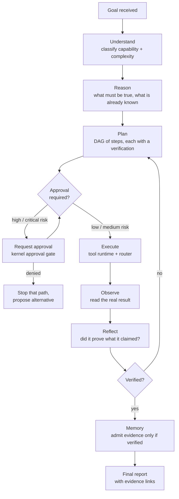

# Cognitive Architecture — AI-2027

This document describes the cognitive loop the platform runs, and maps each
stage to the component in this repository that actually implements it. It is the
contract between the **operating-mind prompts** (`prompts/agent/`) and the
**runtime code** (`python-2027/src/ai2027_protocol/`).

The design goal is not a chatbot that answers. It is a system that takes a goal,
plans it, executes it with tools, verifies the result, and remembers only what
it proved — with a budget it can prove is zero.

## 1. The three systems

| System | What it decides | Where it lives |
| --- | --- | --- |
| **Brain** | *What must be thought about, and how deeply?* Understanding, reasoning, planning, reflection, verification, reporting. | `prompts/agent/*.md` (instructions) + the capability profiles they are served by |
| **Intelligence Router** | *Which capability and which provider serves each step?* | `config/routing_profiles.yaml` + `python-2027/src/ai2027_protocol/routing_profiles.py` |
| **Agent Runtime** | *How is the step executed, and is the result real?* Tool execution, budget, approvals, verification, memory. | `python-2027/src/ai2027_protocol/{agent,router,tools,verify}.py`, `kernel-2027/`, `memory/` |

The Brain is **not** a model. It is a set of decisions about how to think. A
single model can serve several roles with different instructions and contexts;
what must not happen is one undifferentiated call treating a deep diagnosis and
a one-line classification the same way.

## 2. The loop

Every stage is a real component, and every transition is a decision the system
can explain afterwards.

## 3. Stage-by-stage mapping

### 3.1 Understand — classify the goal

**Prompt:** `prompts/agent/UNDERSTANDING.md`
**Code:** `routing_profiles.RoutingRegistry.match_from_text` / `.resolve`

The goal is restated, classified along two axes (primary capability,
complexity), and ambiguity is resolved by asking rather than guessing. The
classification drives routing: it is the input to the Intelligence Router.

The registry resolves a goal to a **profile** — `classify`, `reason`, `coding`,
`planning`, `verification`, `memory`, `vision`, or a local/offline fallback —
using either an explicit task type or text signals. The profile declares the
capability tags, the ordered provider preference, the budget policy and the
approvals the step requires.

### 3.2 Reason — decide what must be true

**Prompt:** `prompts/agent/REASONING.md`
**Code:** the `reason` capability profile, served through `FreeFirstRouter`

Reasoning produces a **claim with premises, an inference and a falsifier**.
Depth is a parameter of the step, matched to the uncertainty, so the free-tier
budget is spent on the steps that are genuinely uncertain rather than on every
step equally.

### 3.3 Plan — build a checkable DAG

**Prompt:** `prompts/agent/PLANNING.md`
**Code:** `python-2027/src/ai2027_protocol/planner_engine.py`

The planner emits structured steps (`PlanStep`) with a title, a capability and a
verification condition. Plans are incremental: a plan never asserts a step whose
dependencies have not landed. Sensitive actions are marked for the approval
gate before they are attempted.

### 3.4 Approve — the kernel is the authority

**Prompt:** `prompts/agent/PLANNING.md` (Approvals)
**Code:** `kernel-2027/kernel2027/approvals.py`, `python-2027/src/ai2027_protocol/bridges.py`

Approval is a security boundary and it is **fail-closed**. The kernel owns the
decision; the runtime asks and reports. A pending approval is never bypassed by
re-wording the request, and a denial ends the path — not the run.

### 3.5 Execute — tools through the router

**Prompt:** `prompts/agent/SYSTEM.md` (Operating Loop)
**Code:** `FreeFirstRouter`, `SandboxToolRuntime`, `tools*.py`

Execution is one step at a time, with every invocation and outcome recorded.
The router enforces the free-first budget: `BudgetGuard` classifies each call
as `LOCAL`, `FREE_TIER`, `UNKNOWN_COST` or `PAID`, and blocks anything that
cannot be proven free. Providers are tried in the profile's preference order
with timeouts, retries and circuit breaking.

### 3.6 Observe and Reflect — compare outcome to plan

**Prompt:** `prompts/agent/REFLECTION.md`
**Code:** `AgentStepTrace`, `AgentSessionState` in `session_state.py`

Reflection is the control signal. It asks whether the step did what it claimed,
whether the evidence is sufficient, what is missing, and what would change the
decision. Replanning after a failed verification is normal control flow, not a
failure of the run.

### 3.7 Verify — prove before declaring

**Prompt:** `prompts/agent/VERIFICATION.md`
**Code:** `python-2027/src/ai2027_protocol/verify.py`

Verification is **independent** of the writer: it re-opens the artifact and
re-reads it, so a bug in the writer's helper cannot produce matching wrong
answers on both sides. Every check returns `VERIFIED`, `UNVERIFIED` or `FAILED`
with lineage. There is no averaging: one failing check fails the artifact.

### 3.8 Remember — evidence-gated memory

**Prompt:** `prompts/agent/SYSTEM.md` (Hard Boundaries)
**Code:** `memory/store.py`, `python-2027/src/ai2027_protocol/celia_memory.py`

Memory is admitted **only** if the kernel already produced a verified record
with a matching hash and a re-hashed artifact on disk. Unverified claims,
reasoning traces and deliberation are never stored as memory. A run's memory
survives restart because it is a file, not a conversation context.

### 3.9 Report — what was actually achieved

**Prompt:** `prompts/agent/FINAL-REPORT.md`
**Code:** the report path of `AutonomousAgent`

The report leads with the status (`VERIFIED`, `PARTIAL`, `BLOCKED`), lists the
evidence with hashes, and states what was **not** done. It never describes
simulated or offline output as a live model result.

## 4. Why the layers are separated

| Separation | Why it matters |
| --- | --- |
| Brain ≠ Router | The Brain decides *what to think*; the Router decides *what can serve it*. Confusing them is how a deep task gets a shallow call. |
| Router ≠ Provider | Profiles name capabilities and provider **kinds**, never model IDs. A retired or renamed model is a catalogue change, not a configuration change. |
| Writer ≠ Verifier | The verifier shares only the file on disk with the writer. A shared helper would let a bug pass both sides. |
| Runtime ≠ Kernel | The runtime asks; the kernel decides on writes, approvals and audit. The runtime never self-authorises. |
| Instructions ≠ Code | Prompts describe behaviour; code enforces it. A prompt that says "never do X" is backed by a gate that actually blocks X. |

## 5. Free-first is a policy, not a promise

The loop's budget is enforced in code:

- `BudgetPolicy.is_free_first` requires `max_spend_usd == 0.0` **and**
  `allow_unknown_cost == False`.
- `RoutingRegistry` refuses any profile that is not free-first at load time, so
  a paid or unknown-cost profile cannot be added by accident.
- `BudgetGuard` blocks unknown-cost and paid calls before they leave the router,
  and records the ledger (`BudgetSnapshot`) so the spend is auditable.
- An API key is never evidence of a free tier.

This is why the `$0` claim is checkable: it is a property of the loaded
configuration and the runtime ledger, not a statement in a document.

## 6. Phased build

| Phase | Deliverable | Closure condition |
| --- | --- | --- |
| **P1** | Instruction files, prompt loader, capability routing profiles, this document, tests | Loading and validation are tested; the router, kernel and deployment are unchanged |
| **P2** | Task-aware routing wired into the router | A routing decision is recorded per step, with provider, model and cost provenance |
| **P3** | Cognitive orchestrator | Multi-step DAGs with dependencies, checkpointing and resume |
| **P4** | Tool and connector execution | Browser, MCP, GitHub and skills execute under approvals |
| **P5** | Memory and retrieval | Evidence survives restart; recall is measured, not asserted |
| **P6** | Real-model evaluation | Quality, latency and cost reports from live probes |

**P1 boundary:** it adds the Brain's instructions and the Router's capability
layer, with tests. It does **not** replace the kernel, the memory gate, the
provider set, or the deployment configuration, and it does not wire routing into
the live router — that is P2, and doing it here would make the change
unreviewable and the failure modes untestable.

## 7. What P1 deliberately does not do

- It does not add a second router beside `FreeFirstRouter`.
- It does not duplicate the kernel's policy or the memory gate.
- It does not treat archived projects as live services.
- It does not store reasoning traces or private deliberation as memory.
- It does not claim a live model result from a simulated or offline path.
- It does not relax any boundary (budget, approval, sandbox) to make a test
  pass.
