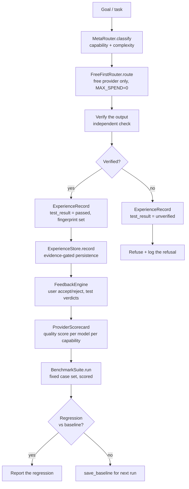

# Continuous Learning & Evaluation — AI-2027 (P2 + P3)

This document describes the **persistent learning and continuous-evaluation**
stage of the AI-2027 intelligence stack. It is the runtime that turns a
free-first router into a system that **learns from what it proved**, measures
its own progress, persists memory across restarts, and refuses to learn from
outcomes nobody verified.

It builds on the **P1 cognitive foundation** (operating-mind prompts +
capability routing). It does **not** replace the kernel, the memory, the
providers, or the deployment configuration — it reuses them.

## 1. What this stage is for

P1 made the platform *decide* well: classify a goal, pick a free-first
capability and provider, execute, verify. That is a closed, single-shot loop.
A platform that never remembers stays a router; it does not *improve*.

This stage adds the **learning loop** around that router:

The loop is the spec. Every stage is a real component; every transition is a
decision the system can explain afterwards.

## 2. The five modules

| Module | Responsibility | Key type |
| --- | --- | --- |
| `intelligence/meta_router.py` | Classify a task, execute it **free-first**, verify it, emit a learning episode. | `MetaRouter` |
| `intelligence/provider_scoring.py` | Score each model per task type from verified outcomes; recommend the best free model for a capability. | `ProviderScorecard` / `ProviderScore` |
| `learning/experience_store.py` | Durable, evidence-gated ledger of verified experiences (SQLite). | `ExperienceStore` / `ExperienceRecord` |
| `learning/feedback_engine.py` | Apply user accept/reject and test verdicts to **verified** episodes only. | `FeedbackEngine` |
| `evaluation/benchmark_suite.py` | Run a fixed case set, score it, persist a baseline, detect regression. | `BenchmarkSuite` / `BenchmarkReport` |
| `reflexion.py` + `reflexion_contracts.py` | Bounded multi-trial verbal reinforcement (`arXiv:2303.11366v4`) under `MAX_SPEND=0`. | `GovernedReflexionLoop` |
| `reflective_graph_memory.py` | Cognee-style relational graph + RMM retrospective utility reranking over SQLite. | `ReflectiveGraphMemory` |
| `reflective_tree.py` | ReTreVal-style bounded reflective tree search (`max_branching<=3`, `max_depth<=3`, `max_expansions<=9`). | `BoundedReflectiveTreeSearch` |
| `reflective_pipeline.py` | End-to-end RMM retrieval -> Reflexion/ReTreVal execution -> retrospective utility + graph indexing. | `ReflectiveCognitivePipeline` |
| `reflexion.py` + `reflexion_contracts.py` | Bounded verbal reinforcement loop (`arXiv:2303.11366v4`): Actor, Evaluator, Self-Reflection over a sliding window `Omega`, AST self-test filtering, and false-positive interception under `POL-BOUNDED-REFLEXION-CAP`. | `GovernedReflexionLoop` / `ReflexionPolicy` |

The modules are deliberately separate so each rule can be enforced in exactly
one place:

- **MAX_SPEND = 0** is enforced in `MetaRouter.assert_free_first()` before any
  execution, and again in `ExperienceStore._validate_record()` (a non-zero cost
  is never admissible).
- **NO VERIFIED RESULT = NO LEARNING** is enforced in
  `ExperienceRecord.is_admissible` (a record must be verified, test `passed`,
  and carry a SHA-256 fingerprint) and in `FeedbackEngine.apply` (feedback on
  an unverified episode raises `FeedbackError`).
- **NO PERSISTENCE = NO COMPLETION** is enforced by `ExperienceStore` (SQLite,
  reopen-durable) and proven by `ExperienceStore.verify_durability()`, which
  re-reads and validates every row.

## 3. The three non-negotiable rules

### 3.1 MAX_SPEND = 0

`MetaRouter.assert_free_first()` inspects the router's `BudgetPolicy` and
raises `FreeFirstPolicyError` if `max_spend_usd != 0.0` or
`allow_unknown_cost` is set. This is checked **before** any provider call, so a
misconfigured budget cannot silently produce a paid or unknown-cost call. The
zero-cost promise is a software policy (`BudgetGuard`), not a hope.

### 3.2 NO VERIFIED RESULT = NO LEARNING

A record enters durable memory only when:

- `verified` is `True`,
- `test_result == "passed"`,
- `output_fingerprint` is a valid SHA-256 hex digest of the verified output.

Anything else is **refused** and written to a `refusals` table — a memory that
drops unverified outcomes silently is blind to its own failures. The feedback
engine applies the same gate: it will not fold a user accept/reject or a test
verdict onto an episode that was not verified.

### 3.3 NO PERSISTENCE = NO COMPLETION

Learning memory is a SQLite ledger. A capability is not complete until its
episodes survive a restart. `ExperienceStore.verify_durability()` reopens the
store and re-validates every row, so "it persisted" is a checked property, not
an assumption. The benchmark baseline is persisted the same way: a run without
a stored baseline cannot claim progress against a prior version.

## 4. The privacy guard

`MetaRouter` is local-only by default (`PrivacyPolicy(allow_remote=False)`).
The privacy policy decides which provider **kinds** may receive content; the
router builds each request so that only permitted kinds are listed as preferred
and `allow_remote` is `False` unless the operator explicitly opts in and at
least one permitted kind exists. Repo and user content is never fanned out to
multiple remote providers automatically without a policy and consent.

This honours the free-tier caveats: OpenRouter free (50 req/day, 20 req/min),
Gemini free-tier data-usage terms (never send secrets or sensitive files),
NVIDIA free endpoints (dev/test only), and Ollama Cloud billing on usage.

## 5. What it reuses (and what it does not do)

**Reused, not rebuilt:**

- `FreeFirstRouter`, `BudgetGuard`, `CircuitBreaker` (`router.py`) — execution.
- `RoutingRegistry` / `load_routing_registry` (`routing_profiles.py`) — classification.
- `lexical_embed_text` / `cosine_similarity` (`celia_memory.py`) — experience retrieval.
- `ExperienceStore` is the single new persistence boundary; the agent runtime
  and session store remain the execution/session layer.

**Deliberately not done here:** automatic model-weight training. Learning is
from *usage-result feedback and routing-policy improvement*, not from
fine-tuning weights. LoRA/QLoRA on a specialized open model is a later,
separate step that needs clean training data and a GPU — neither of which the
free-tier key set guarantees.

## 6. The learning episode

Every episode captures:

- task type + complexity,
- model / provider used,
- latency, attempt count,
- test result (`passed` / `failed` / `unverified`),
- quality score,
- user accept / reject (or `None`),
- output fingerprint (SHA-256 of the verified output).

This is the atomic unit of learning: enough to replay, enough to audit, and
nothing that was not verified.

## 7. Measurement (P3)

`BenchmarkSuite` runs a fixed set of cases across six categories —
`python_engineering`, `architecture`, `reasoning`, `research`,
`agent_execution`, `long_term_memory` — and scores each as the fraction of
cases whose episode was verified. `save_baseline` / `load_baseline` / `compare`
persist a baseline and report any category whose fresh score falls below the
baseline. The platform can therefore measure itself against a prior version
and detect regression, not just produce output.

## 8. Acceptance standard

This stage is complete when the platform:

- learns from past tasks without memorizing errors,
- picks the best free model per task from verified outcomes,
- measures its own progress against a prior version and detects regression,
- persists memory across restarts (verified by `verify_durability`),
- refuses unproven claims (unverified outcomes are never admitted to memory),
- evolves its code via reviewable, revertible changes.

A stage is **not** complete just because its files exist: it requires real
execution, data persistence, and reproducible measurements. The test suite
exercises each rule directly (refusal of unverified records, the zero-spend
guard, durability across reopen, regression detection), so the rules are
enforced by running code, not by documentation.

## 9. Bounded Verbal Reinforcement — Governed Reflexion (`arXiv:2303.11366v4`)

`GovernedReflexionLoop` (`python-2027/src/ai2027_protocol/reflexion.py` and
`reflexion_contracts.py`) adapts Shinn et al. (2023), *Reflexion: Language Agents
with Verbal Reinforcement Learning*, to the platform's hard governance gates:

- **Three replaceable roles (`M_a`, `M_e`, `M_sr`):** the Actor executes via
  `MetaRouter` (`MAX_SPEND = 0` asserted before every generation), `EvaluatorProtocol`
  scores trajectories and checks §4.1 pathologies (`repeated_action_cycle`,
  `step_cap_exceeded`), and `SelfReflectorProtocol` (`DeterministicSelfReflector`
  or free-first `RouterSelfReflector`) emits structured cues matching
  `prompts/agent/REFLECTION.md` (`claim`, `observation`, `gap`, `next_action`,
  `correction`).
- **Sliding-window episodic buffer (`Omega`):** `ReflexionMemoryBuffer` caps
  in-context verbal reflections to `1 <= memory_window <= 5` (default `3`; `1`
  for programming) so prompt windows never grow unboundedly, and halts early on
  repeated identical reflections (`halted_stagnation`) instead of spinning in a
  WebShop-style local minimum.
- **AST unit-test filter (`§4.3`):** `filter_valid_python_tests` parses proposed
  Python unit tests with `ast.parse`, rejects syntax errors, side-effecting
  imports/builtins (`os`, `subprocess`, `open`, `eval`, `exec`, etc.),
  deduplicates AST-identical assertions, and caps the suite at `max_self_tests`
  (default `6`).
- **False-positive interception & zero memory poisoning:** Shinn et al. (§4.3,
  Table 2) reported MBPP Python regression (`80.1% -> 77.1%`) caused by internal
  unit-test false positives (`FP = 0.16`). When
  `require_independent_verification=True`, any non-independent passing
  self-evaluation is cross-checked by the independent verifier; false positives
  are intercepted and verbal reflection continues. Unverified or halted runs
  (`halted_max_retries`, `halted_stagnation`, `halted_stop`) emit
  `ExperienceRecord(verified=False)` and a SHA-256 `audit_chain` under
  `POL-BOUNDED-REFLEXION-CAP`, so `ExperienceStore.record(...)` refuses them into
  `refusals` and durable memory is never polluted by failed trials.

## 10. Relational & Reflective Utility Memory (`Cognee + RMM`)

`ReflectiveGraphMemory` (`python-2027/src/ai2027_protocol/reflective_graph_memory.py`)
extends `ExperienceStore` with standard-library SQLite relational and utility
tables (`memory_nodes`, `memory_edges`, `episode_node_links`,
`edge_fingerprint_links`, `retrieval_utility`):

- **Strict admissibility gate:** `index_episode(...)` delegates admission to
  `ExperienceStore.record(...)` and refuses unverified or non-zero-cost episodes
  without creating graph nodes or edges.
- **Fingerprint-idempotent indexing:** nodes and edges are linked to
  `output_fingerprint` via composite primary keys so re-indexing the same
  verified artifact never inflates `fingerprint_count` or edge `weight`.
- **Retrospective utility reranking (RMM):** `record_retrieval_outcome(...)`
  tracks whether retrieved episodes contributed to an independently verified
  downstream task, and `search(..., rerank_by_utility=True)` re-ranks candidates
  with Laplace-smoothed Beta(1, 1) utility `(helpful + 1) / (retrieved + 2)`
  without deleting historical audit records.

## 11. Bounded Reflective Tree Search (`ReTreVal` / `ToT + Reflexion`)

`BoundedReflectiveTreeSearch` (`python-2027/src/ai2027_protocol/reflective_tree.py`)
addresses linear ReAct trajectory traps under `POL-BOUNDED-REFLECTIVE-TREE`:

- **Hard combinatorial caps:** `TreeSearchPolicy` enforces `max_branching <= 3`,
  `max_depth <= 3`, `max_expansions <= 9`, and `MAX_SPEND = 0` via
  `MetaRouter.assert_free_first()` before every branch expansion.
- **Cross-branch verbal reflection:** `VerbalReflection` cues emitted from failed
  branches are passed into subsequent sibling and child expansions so sibling
  paths avoid repeating prior failure modes.
- **Independent verification & hash chain:** non-independent passing scores are
  cross-checked by `meta_router.verifier`, every expansion is linked in a
  SHA-256 `TreeAuditEntry` chain (`verify_tree_audit_chain`), and only an
  independently verified winning path emits `ExperienceRecord(verified=True)`.

## 12. Closed-Loop Reflective Pipeline (`ReflectiveCognitivePipeline`)

`ReflectiveCognitivePipeline` (`python-2027/src/ai2027_protocol/reflective_pipeline.py`)
wires `ReflectiveGraphMemory` directly to `GovernedReflexionLoop` and
`BoundedReflectiveTreeSearch`:

1. Retrieves up to `k_lessons` utility-ranked verified episodes (`RMM` prior context).
2. Executes via sequential `reflexion` or branching `tree` search under `MAX_SPEND = 0`.
3. Automatically records `record_retrieval_outcome(..., downstream_verified=verified)`
   so helpful retrieved episodes gain posterior utility and unhelpful ones decay.
4. Admits the winning `ExperienceRecord` and overcome `failure_mode` graph nodes
   only when `verified=True`, refusing unverified runs into `refusals`.

